# Optimización de Portafolios con Acciones de la Bolsa de Valores de Colombia

**Markowitz, medición de riesgo con Monte Carlo t-Student y validación walk-forward con costos de transacción**

Juan Camilo Ospina Cardona · Ingeniero Financiero 

<p align="center">
  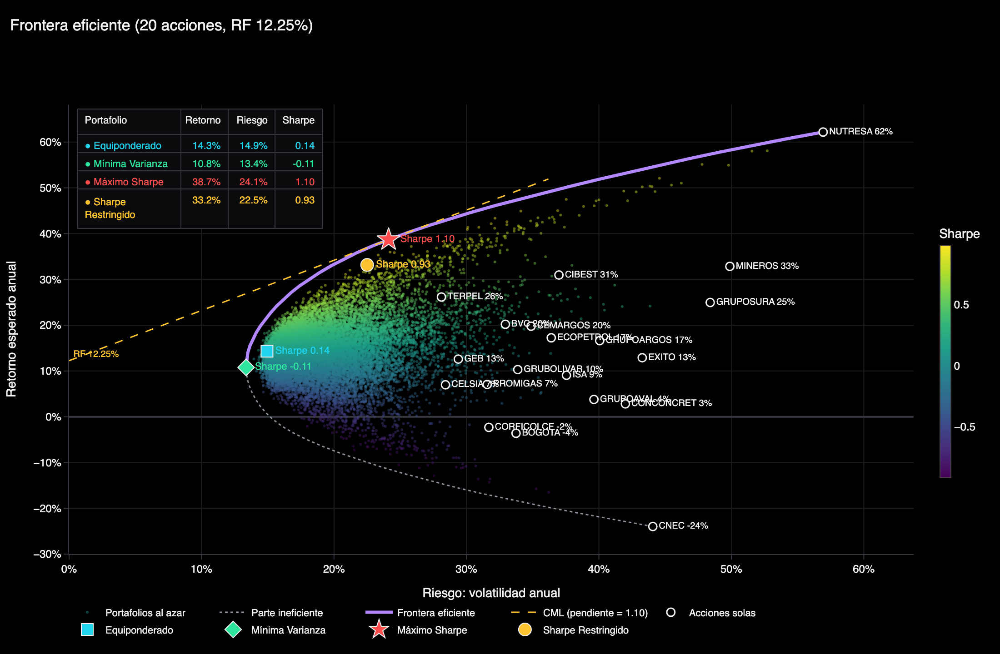
</p>

---

## Resumen

Este proyecto evalúa si la optimización media-varianza de Markowitz genera portafolios superiores en el mercado accionario colombiano una vez se controla por el sesgo de información futura (*look-ahead bias*) y por los costos de transacción. Se analizan 30 acciones de la BVC entre enero de 2022 y octubre de 2026. Tras aplicar un filtro de liquidez, quedan 20 acciones, con los cuales se construyen cuatro portafolios.

| Portafolio | Criterio |
|---|---|
| **Equiponderado** | Peso idéntico para todos los activos. |
| **Mínima Varianza** | Minimiza la volatilidad del portafolio. |
| **Máximo Sharpe** | Maximiza el exceso de retorno por unidad de volatilidad. |
| **Sharpe Restringido** | Máximo Sharpe con pesos acotados entre 2% y 35% por activo. |

## Metodología

1. **Datos y liquidez.** Se descargan precios ajustados desde Yahoo Finance. Se excluyen los activos con menos de 90% de días con cotización o menos de 40% de días con variación de precio. Los precios repetidos subestiman la volatilidad y la correlación, lo que sesga al optimizador.
2. **Optimización.** Se resuelve con `scipy.optimize` (SLSQP), sin ventas en corto y con una tasa libre de riesgo de 12.25% anual.
3. **Desempeño.** Para cada portafolio se calculan Sharpe, Sortino, Calmar, CAGR y máximo drawdown.
4. **Riesgo.** VaR y CVaR diarios al 95% y 99% con cuatro métodos: histórico, paramétrico, Monte Carlo normal y Monte Carlo t-Student. Los grados de libertad de la t se estiman por máxima verosimilitud.
5. **Backtesting del VaR.** Pruebas de cobertura incondicional (Kupiec, 1995) e independencia (Christoffersen, 1998).
6. **Walk-forward.** Rebalanceo mensual usando solo información disponible hasta el día anterior, con un costo de 0.3% sobre la rotación.
7. **Análisis complementario.** Contribución marginal al riesgo, escenarios de estrés y sensibilidad a la tasa libre de riesgo.

## Resultados

### Desempeño fuera de muestra (enero 2022 – octubre 2026, con costos)

| Portafolio | Sharpe dentro de muestra | Sharpe walk-forward | Valor final de $1 | CAGR | Máx. drawdown |
|---|---|---|---|---|---|
| Equiponderado | 0.14 | 0.28 | 2.06 | 16.8% | -28.4% |
| Mínima Varianza | -0.11 | -0.05 | 1.61 | 10.8% | -36.8% |
| Máximo Sharpe | 1.10 | 0.38 | 2.48 | 21.5% | -33.7% |
| **Sharpe Restringido** | 0.93 | **0.49** | **2.70** | **23.8%** | **-26.5%** |

<p align="center">
  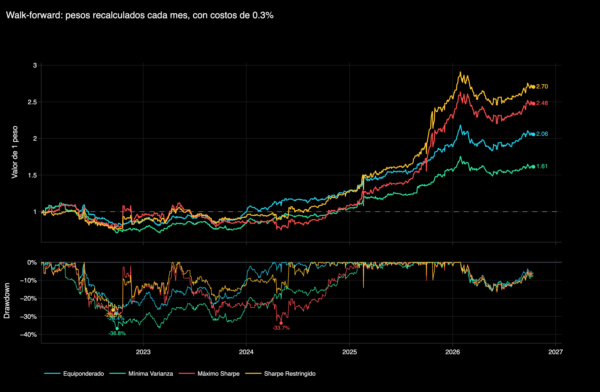
</p>

El Máximo Sharpe es el mejor dentro de la muestra: supera a 20,000 portafolios aleatorios y es el mejor con cualquier tasa libre de riesgo entre 6% y 15%. Sin embargo, su Sharpe cae 65% en la validación fuera de muestra wf. La causa es el **error de estimación**: el optimizador trata el retorno histórico como si fuera conocido y concentra el capital en los activos con mejor desempeño pasado. El Sharpe Restringido limita esa concentración y obtiene el mejor resultado fuera de muestra, con menor rotación (14.6% mensual frente a 26.5%).

### Composición y concentración del riesgo

<p align="center">
  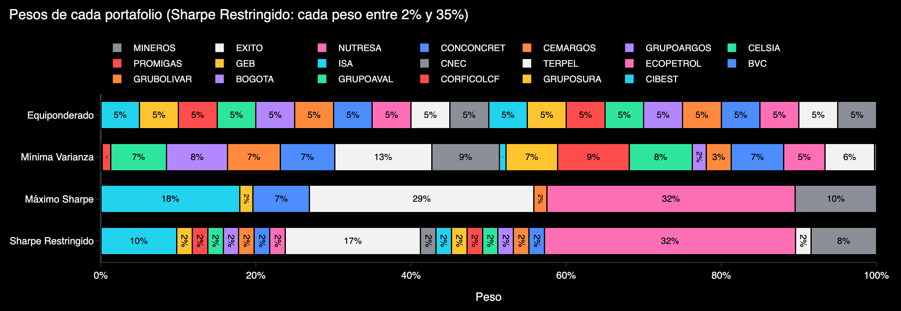
</p>

El Máximo Sharpe asigna capital a 7 de los 20 acciones. NUTRESA, TERPEL y CIBEST explican el 88% de su varianza. NUTRESA, por sí sola, aporta el 60% del riesgo con el 32% del capital.

<p align="center">
  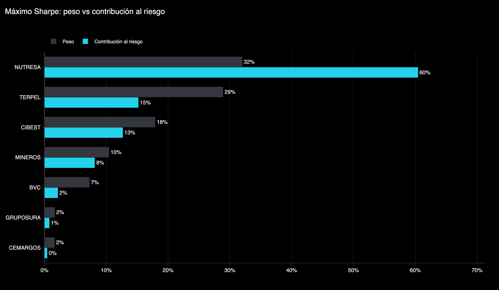
</p>

### VaR y CVaR

Los retornos presentan una curtosis en exceso entre 8 y 49. La estimación por máxima verosimilitud selecciona una t-Student con **3 grados de libertad**, lo que confirma colas pesadas. Por esta razón, las conclusiones de riesgo se basan en el Monte Carlo t-Student (100,000 simulaciones).

| Portafolio (capital: COP 100 millones) | VaR 99% | CVaR 99% |
|---|---|---|
| Mínima Varianza | 2.14% | 3.31% |
| Sharpe Restringido | 3.55% | 5.52% |
| Máximo Sharpe | 3.79% | 5.90% |

<p align="center">
  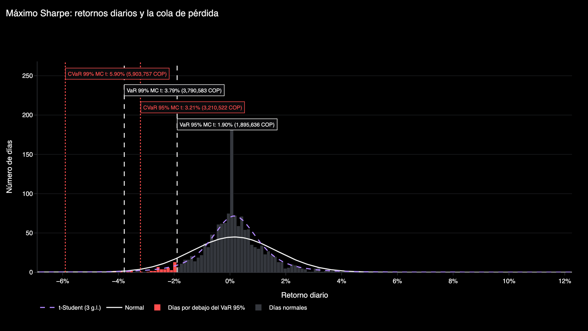
</p>

En el backtesting, el Monte Carlo t-Student pasa la prueba de Kupiec en los 8 casos evaluados (4 portafolios × 2 niveles de confianza). Los modelos normales la fallan en 3 casos, porque subestiman la frecuencia de pérdidas extremas. En 2 casos se rechaza la independencia de Christoffersen: las pérdidas tienden a agruparse, lo cual sugiere incorporar volatilidad condicional, se sugiere implementar GARCH.

<p align="center">
  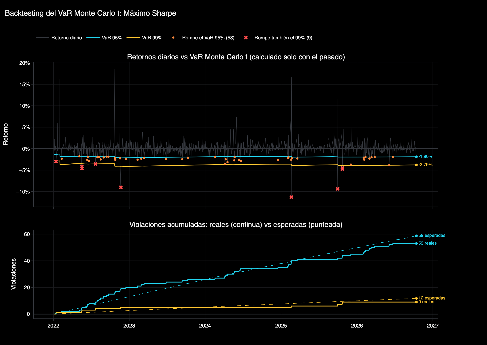
</p>

## Conclusión

La optimización sin restricciones produce portafolios concentrados y sensibles al error de estimación, cuyo desempeño histórico no se sostiene fuera de muestra. Imponer límites de peso por activo es una forma simple y efectiva de regularización. En este estudio, el Sharpe Restringido obtuvo el mayor Sharpe, el mayor valor final y el menor drawdown en la validación walk-forward.

<details>
<summary><b>Gráficas adicionales</b></summary>

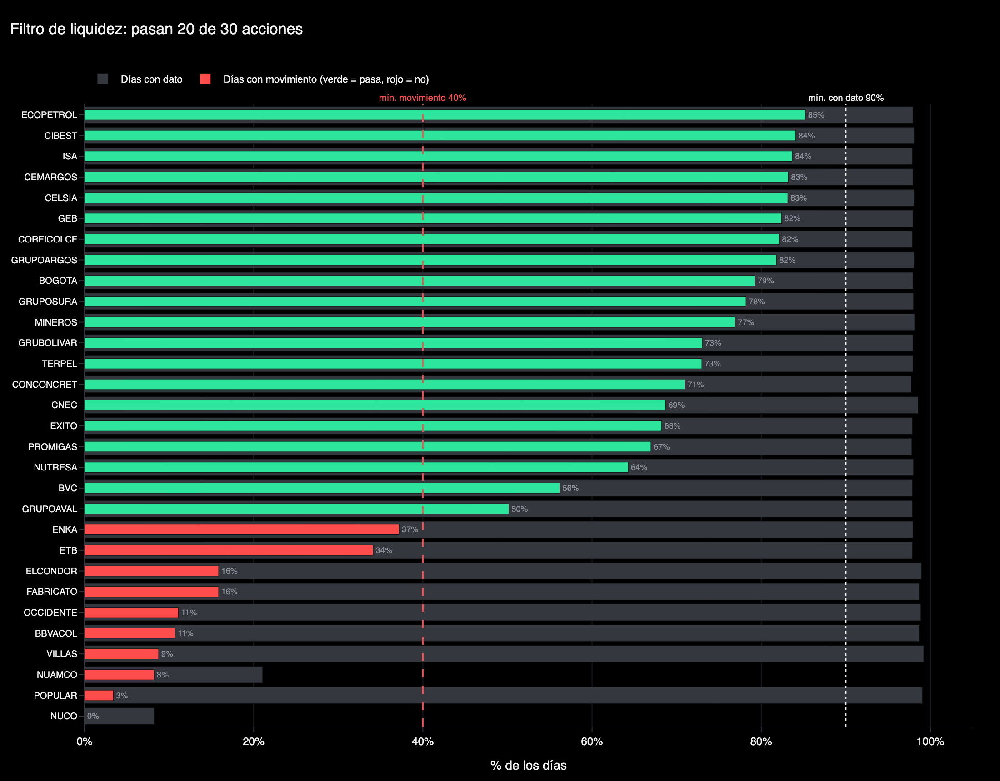
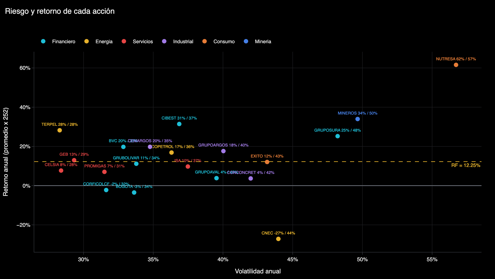
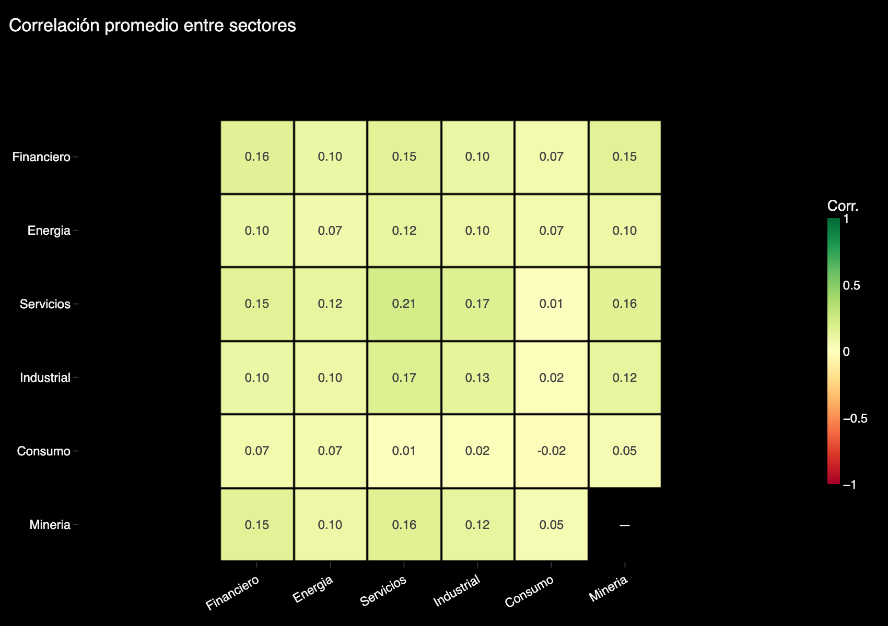
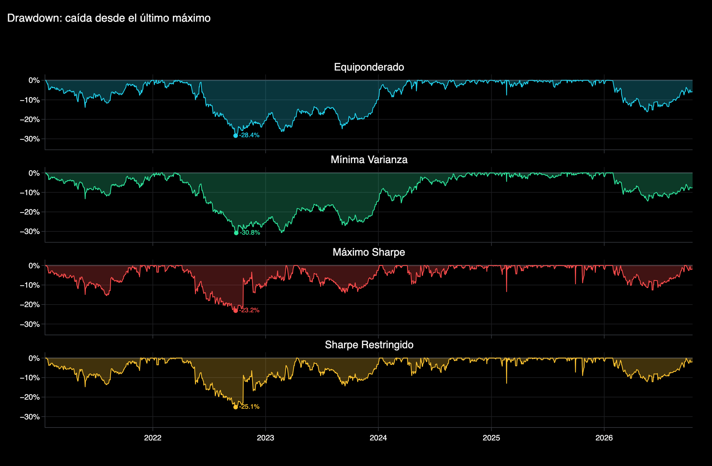
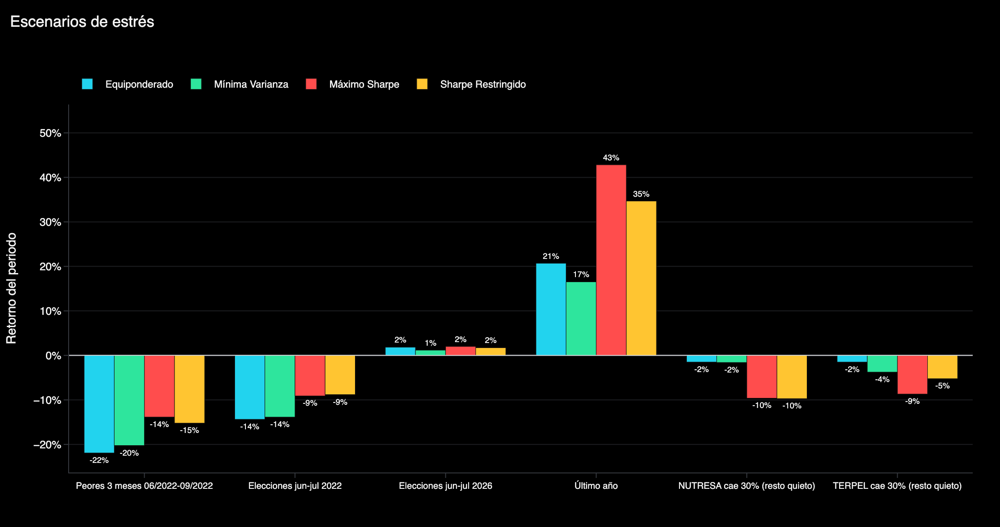

</details>

## Estructura del repositorio

```
portafolio-bvc/
├── portafolio_bvc.ipynb   # análisis completo
├── requirements.txt
├── README.md
└── figuras/               # gráficas generadas por el notebook
```

## Reproducción

```bash
git clone https://github.com/TU_USUARIO/portafolio-bvc.git
cd portafolio-bvc
pip install -r requirements.txt
jupyter notebook portafolio_bvc.ipynb
```


## Limitaciones y consideraciones

- **Sesgo de supervivencia:** solo se incluyen acciones listadas actualmente.
- **Supuestos fijos:** la tasa libre de riesgo y el costo de transacción son constantes.
- **Retorno esperado:** se estima con la media histórica, un estimador con alto error. Alternativas: Black-Litterman o *shrinkage*.
- **Covarianza:** se podría estabilizar con Ledoit-Wolf.
- **Volatilidad:** el Monte Carlo asume volatilidad constante. Un GARCH capturaría la agrupación de pérdidas detectada por Christoffersen.

## Referencias

- Markowitz, H. (1952). Portfolio Selection. *The Journal of Finance*, 7(1), 77–91.
- Kupiec, P. (1995). Techniques for verifying the accuracy of risk measurement models. *The Journal of Derivatives*, 3(2), 73–84.
- Christoffersen, P. (1998). Evaluating interval forecasts. *International Economic Review*, 39(4), 841–862.

---

*Proyecto con fines educativos*
